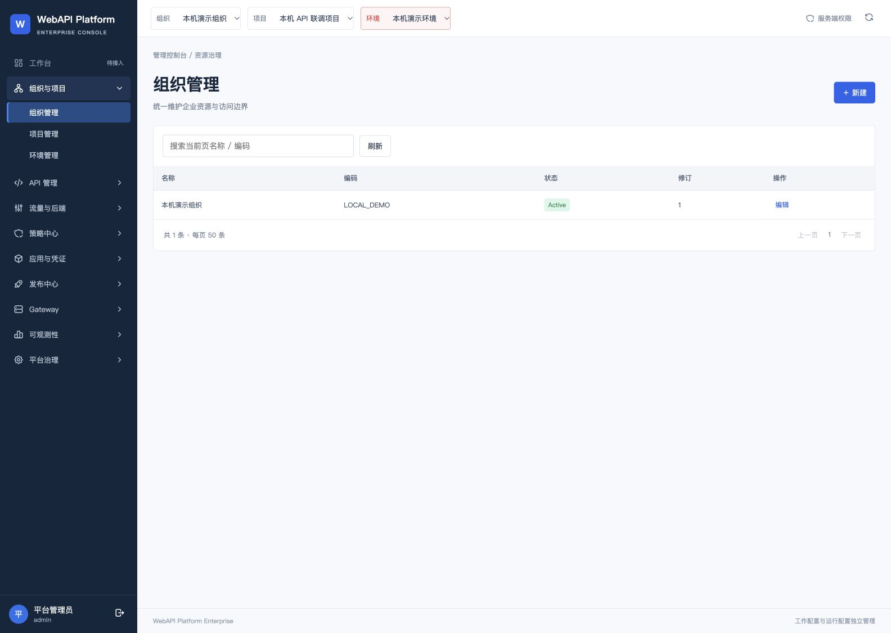
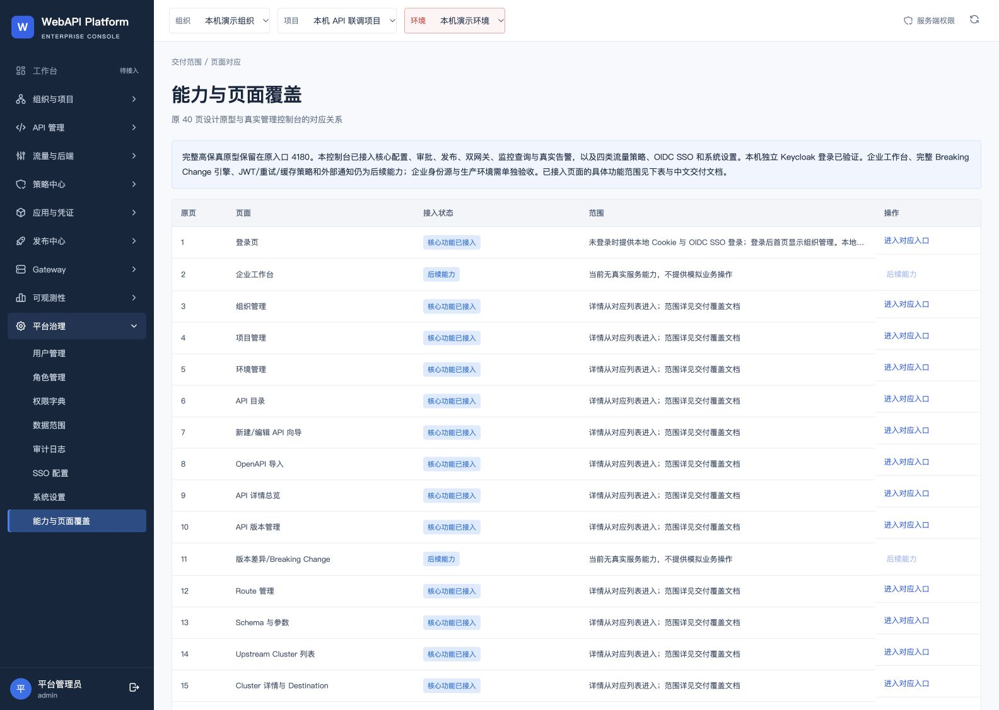
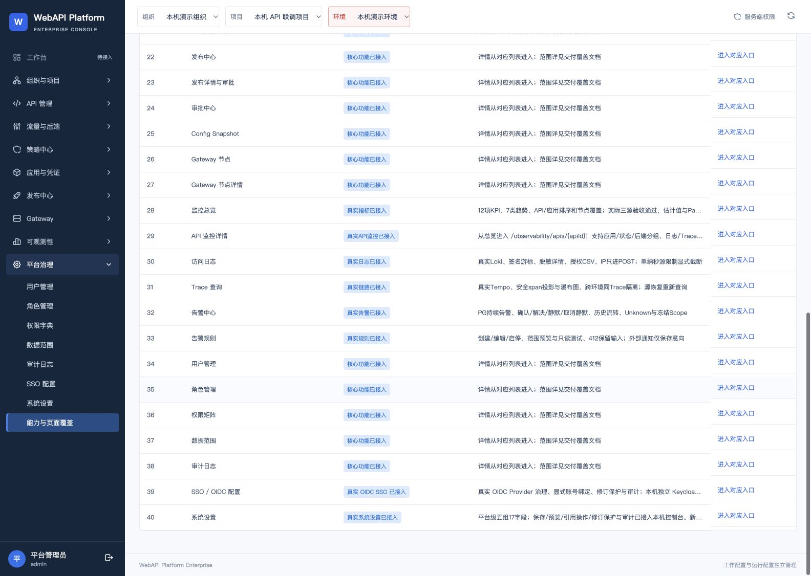

# 4192 导航与交付范围校正结果

核验日期：2026-10-06。应用提交：`6fcb6bb90d8c65a69104124be0fc4f18fa2512d7`。本轮已本地合并、构建、冷备份、升级并达到 Ready，未推送远端。

## 本轮修正

首页 `/` 仍显示组织管理，现在会展开“组织与项目”并选中组织管理。功能覆盖页不再将已部署的 OIDC SSO、系统设置和四类策略描述为未升级；保留原 40 条页面编号、名称和入口映射。新增当前运行摘要，纠正 Keycloak 端口说明。

## 页面检查

| 步骤 | 页面及观察 | 结果 |
|---|---|---|
| 1 | 首页组织管理；当前链接 `/organizations`，展开组数 1 | 修正后通过 |
| 2 | 能力覆盖表 40 行；第 2、11 行仍标后续；第 39、40 行反映实际部署 | 修正后通过 |
| 3 | SSO 身份源；独立 Keycloak 4194、已启用、修订 r4 | 本机页面通过 |
| 4 | 系统设置；五组 17 字段、平台范围、保存预览入口 | 本机页面通过 |
| 5 | 恢复 4180 原型；“页面导航”显示全部 40 个入口 | 导航清单通过 |

页面采用现有深蓝 Shell、密集表格和分组设置；当前页面状态与业务范围说明一致。首页和覆盖页更新后实测视口为 1584×1126，无水平溢出；SSO、系统设置及更新前覆盖页截图为 1440×1023。临时视口覆盖已重置。窄侧栏浏览器视口出现换行，本轮没有进行移动端或完整 WCAG 验收。覆盖表长说明显示省略号，39、40 行完整文字已通过 DOM 核对。

## 验证与保留

- 首页真实 SSR 回归用例先失败、后通过；完整控制台及运行工具测试 172 项通过，0 失败、0 跳过；TypeScript 检查通过。
- 独立代码审查未发现重大问题；关于当前运行摘要链接的轻微问题已关闭。
- 使用固定提交 Git archive 构建，线上三个静态文件 SHA 与构建产物一致。镜像身份见 `immutable-build.json`。
- 七个所属平台卷冷备份与逻辑数据库备份完成并校验；独立 IdP 未重建。此轮未执行新的备份恢复演练。
- 原三账号登录、真实 Keycloak Viewer 登录、Viewer 写入 403、同客户端退出后 401 已验证。
- 31 张业务/治理表、原账号密码、SSO、业务配置 v4/seq4 保留；41 个原本机文件及 18 个历史 ZIP 字节未变。96 个固定维护工具文件校验一致。
- 两个实际网关 4196、4197 请求均返回 200；未产生新业务发布或伪造发布确认。

## 范围与后续

4180 是原 40 页交互原型，4192 是真实管理控制台。40 条映射中的 38 条有真实功能入口或对应父页入口，并不表示 38 个独立页面全部功能完成。本轮未逐页重新验收全部 CRUD，也未重复执行未改变的后端全量测试。

企业工作台和完整 Breaking Change 引擎仍待实施；JWT、重试、缓存、外部通知及企业实际端点仍需后续工作。企业 IdP、生产 TLS/HA、容量/SLA 等需要目标环境验收。本机 Ready 不代表生产验收通过。

当前能力和端口详见 [当前本机运行摘要](../../deployment/current-local-status.md)。原始验证摘要见 `source-commit.json`、`merge.json`、`cold-backup.json`、`upgrade.json`、`final.json` 和 `ui-qa.json`。密码、API Key、Cookie、私有运行基线及冷备份不包含在交付附件中。
