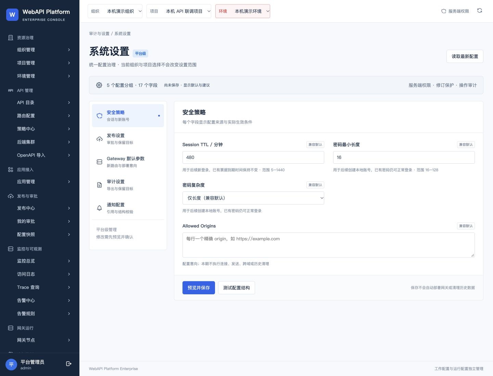
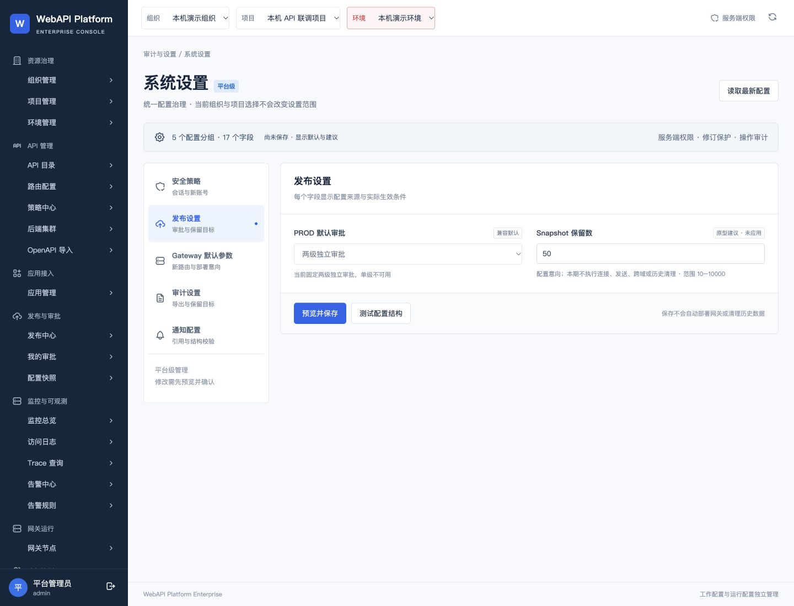
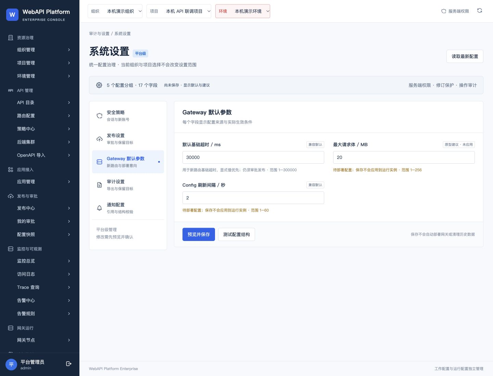
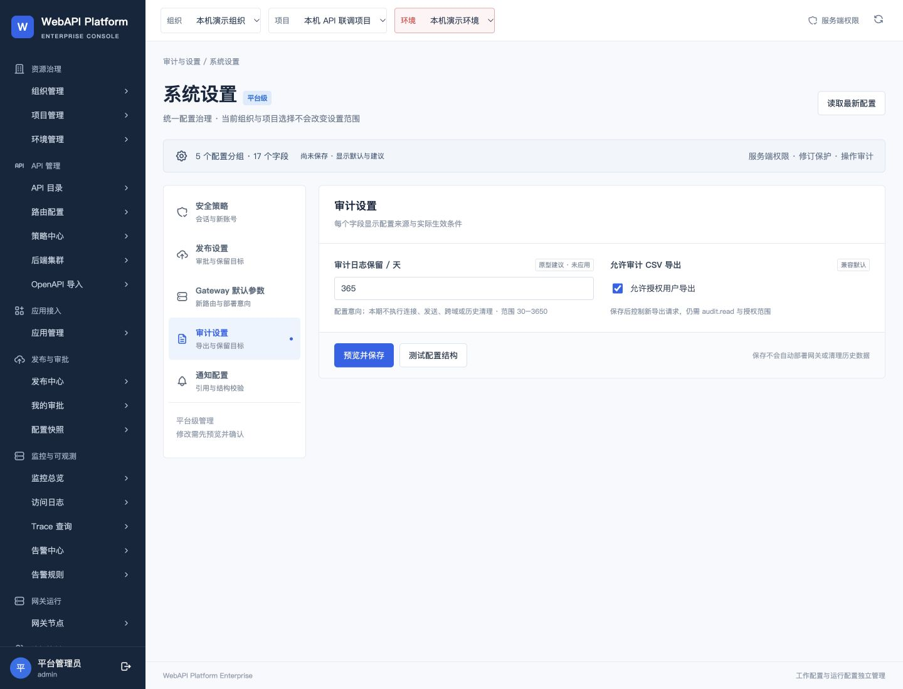
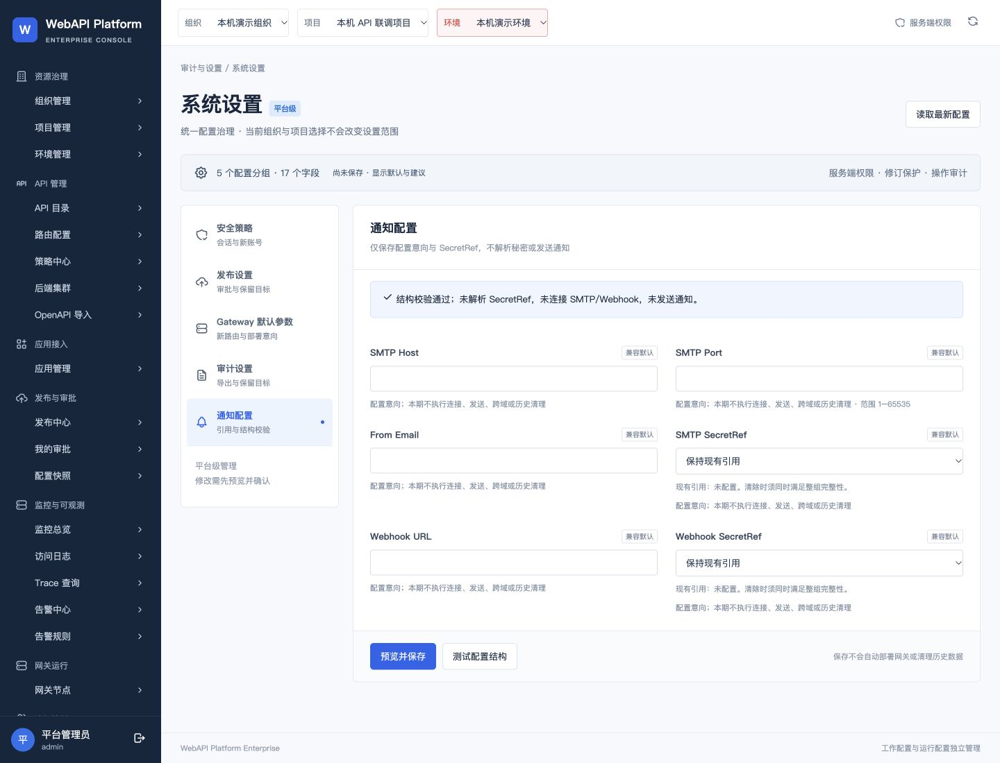
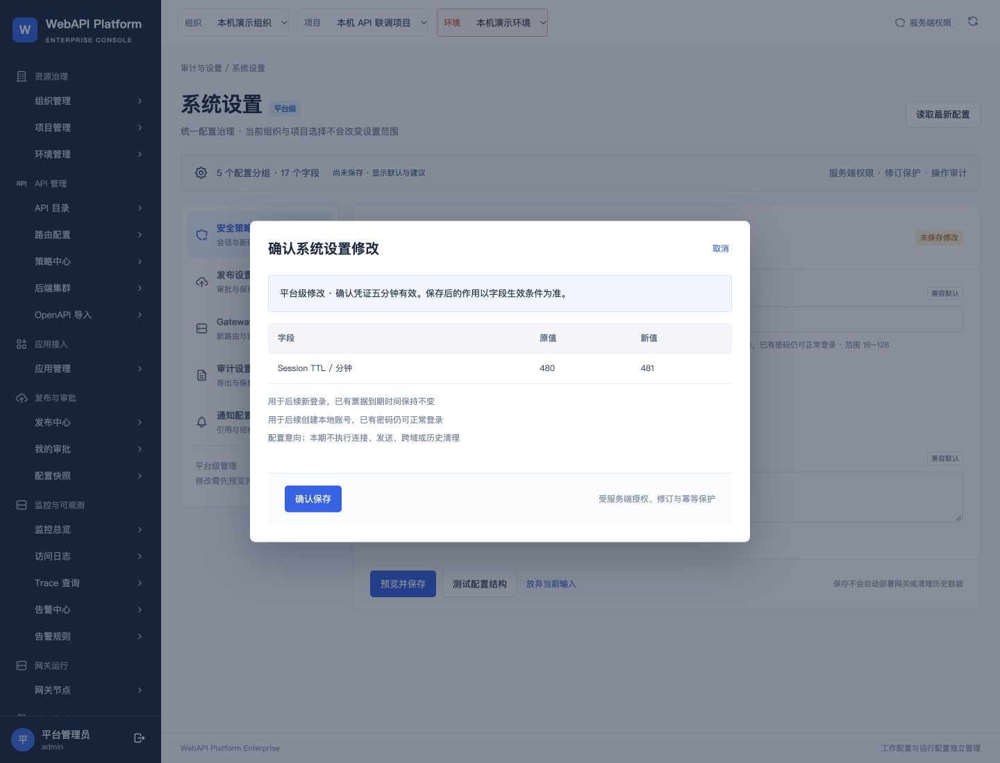

# Chrome 浏览器复验记录

本轮通过备用Chrome通道补验4192实际页面。内置浏览器此前受原生确认框阻塞；Chrome分组点击正常，说明已补验动作确实产生页面状态变化。本轮没有改源码、提交、部署、发布或保存平台设置。

## 1. 原管理员登录与安全默认值

通过：平台级范围、5组17字段、480分钟兼容默认可见。

## 2. 发布设置鼠标导航

通过：进入发布分组，固定两级独立审批及保留数生效边界可见。

## 3. Gateway默认参数鼠标导航

通过：进入网关分组，30000毫秒兼容值及需部署说明可见。

## 4. 审计设置鼠标导航

通过：进入审计分组，CSV导出兼容启用及授权约束可见。

## 5. 通知结构校验

通过：按钮返回结构校验通过，明确未解析SecretRef、未连接或发送。

## 6. 480到481修改预览与取消

通过：差异、确认保存及取消控件可见；取消后dialog不可见，未执行确认保存。

## 7. 弃稿确认与480恢复：受阻

在Chrome点击“放弃当前输入”后，工具明确报告“确认放弃当前未保存输入？”原生confirm。getJsDialog未返回并超时；使用受支持的Chrome原生界面检查时，工具报告Mac已锁定且自动解锁失败。不能把弃稿记为完成。481只是未保存草稿，不曾点击确认保存。

## 8. 审计CSV浏览器下载：尚未执行

先解锁Mac并关闭该测试原生confirm，再补测真实浏览器下载。上一阶段服务器CSV200证据仍有效，不能替代本次浏览器下载。

## 视觉和验收边界

六张真实截图均保存后查看；本轮字段层级、来源标签、生效条件与确认差异可读，没有观察到表单遮挡或截断。1440桌面目标，页面左侧导航较长并滚动，不据截图宣称完整无障碍或移动端验收。第39页SSO、外部通知投递及生产能力仍不属于本轮完成范围。

Ruling: 内置浏览器受阻时，按Product Design浏览器选择规则使用独立Chrome标签页完成可执行的验收；不绕过工具限制。代价：新增一次原账号登录和六张证据截图；原生确认处理又遇到设备锁定，剩余两步仍须解锁后执行。
