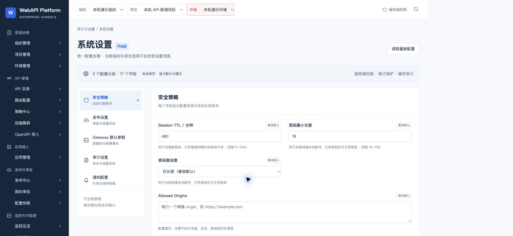
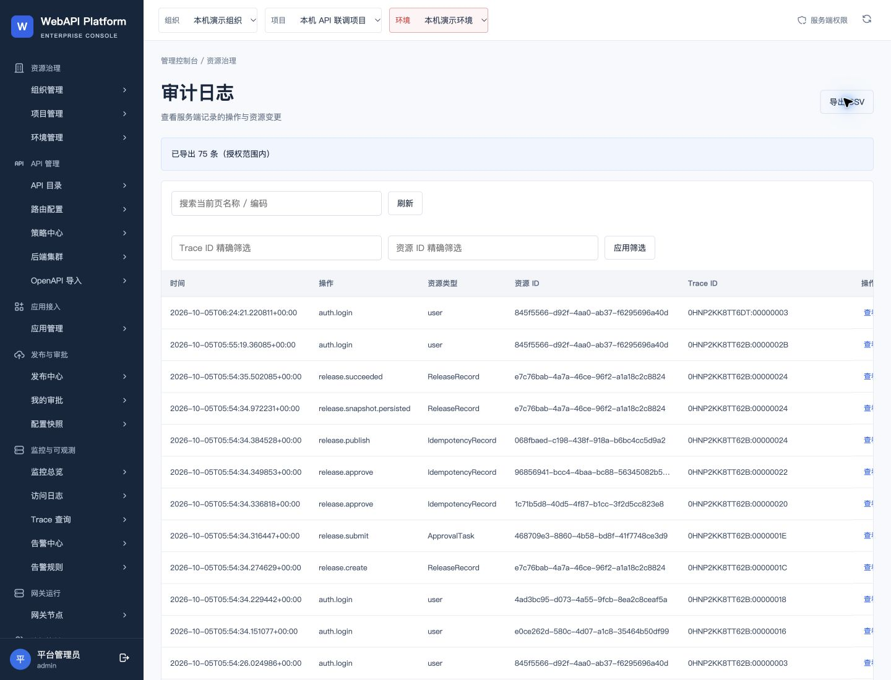
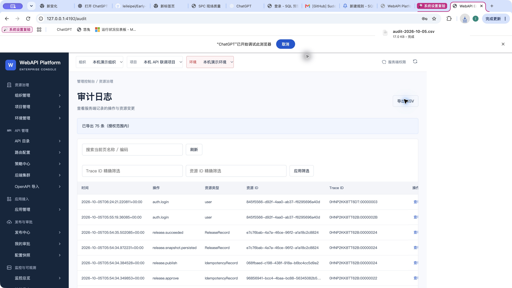
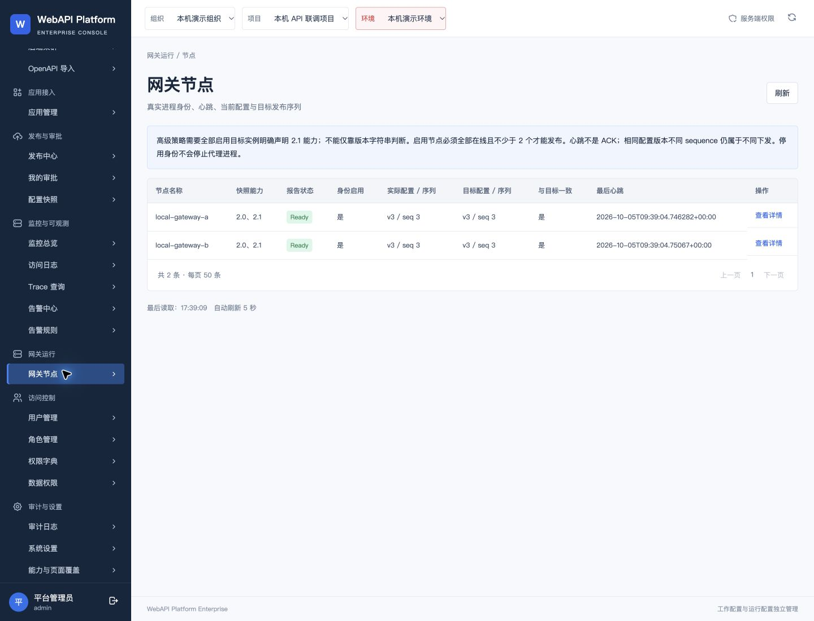
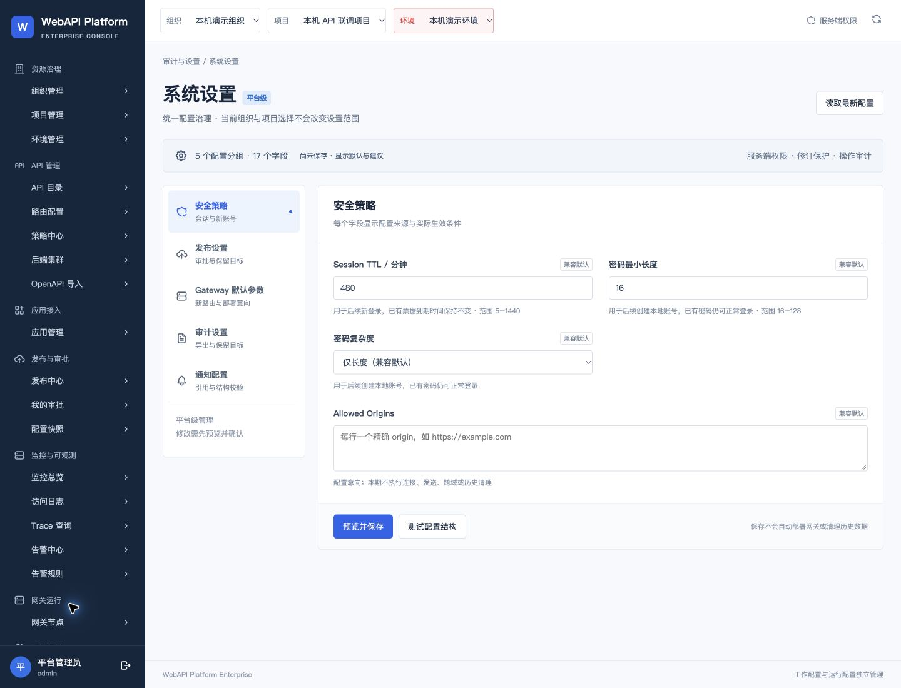

# 系统设置：Chrome浏览器最终复验

2026-10-05完成原4192实际页面补验：10项交互检查通过，11张实际截图保存后查看。此前设备锁定及内置浏览器原生confirm限制保留为历史证据；本轮在解锁后通过Chrome原生AX完成弃稿，并验证真实CSV下载。

固定源码`f4e2cc3d81f0467fd48894127b26bc1ec6138389`，实际镜像`sha256:688cc971945d8b4a0cab6aa0bdcfd85b910ad3ec6b88c78f335411acad6aefba`。当前服务复核`2026-10-05T09:38:55.942Z`：Ready，双网关ACK v3/seq3，设置表0行，原凭据/业务ID/历史快照保全。

## 1. 原管理员登录与安全默认值：通过

通过：平台级范围、5组17字段、480分钟兼容默认可见。

## 2. 发布设置鼠标导航：通过

通过：进入发布分组，固定两级独立审批及保留数生效边界可见。

## 3. Gateway默认参数鼠标导航：通过

通过：进入网关分组，30000毫秒兼容值及需部署说明可见。

## 4. 审计设置鼠标导航：通过

通过：进入审计分组，CSV导出兼容启用及授权约束可见。

## 5. 通知结构校验：通过

通过：按钮返回结构校验通过，明确未解析SecretRef、未连接或发送。

## 6. 480到481修改预览与取消：通过

通过：差异、确认保存及取消控件可见；取消后dialog不可见，未执行确认保存。

## 7. 弃稿确认与480恢复：通过

手动解锁后通过Chrome原生AX选择确认弃稿；页面值480且弃稿按钮消失，未执行确认保存。

## 8. 审计导航与真实CSV下载：通过

鼠标打开审计并点击导出，页面已导出75条，Chrome下载UI显示完成；实际下载文件75行、10列、17452字节。事件等待工具超时不能误认为下载失败。

## 9. 当前网关节点导航与ACK：通过

鼠标打开节点，两实例Ready、实际和目标v3/seq3一致；后台只读复核ACK为true。

## 10. 返回系统设置与草稿清理：通过

鼠标返回系统设置；默认480、弃稿按钮不可见；后台设置0行，保留已验证Chrome页面。

## CSV实际文件核对

实际Chrome下载`audit-2026-10-05.csv`，75条记录、10列、17452字节。SHA256：`817fb5175dcc203f0e0c7c4a99be03e032c73f03d9a2e618294bc4f92b8de322`。字段：id, createdAt, actorId, action, resourceType, resourceId, organizationId, projectId, environmentId, traceId。CSV原数据保留在本机下载目录，不进入公开交付ZIP。

## 视觉、流程及无障碍观察

截图1–7和11显示统一字段来源、生效条件及修改差异；分组切换、结构反馈、预览取消和弃稿实际可操作。截图8–9说明导出结果与实际下载一致；截图10说明运行实例与目标一致。11张截图均已保存并查看，未用重新绘制的图片替代。审计表含较长ID，在1440下横向滚动，右侧操作列可能需要滚动查看；原生下载完成截图含浏览器框架，尺寸见final-qa.json，未将其当成1440页面截图。第7张在解锁后视口曾恢复为默认，保留实际尺寸；第8/10/11张重新采用1440×1100。

分组、字段、预览取消及原生确认按钮有可定位标签；本轮没有完整键盘遍历、屏幕阅读器及WCAG测试，不能据此宣称无障碍合规。原40页原型及其他模块仍按各自交付边界；SSO、通知投递与生产验收没有因本轮补验而完成。

## 工具问题和处理裁决

Ruling: 内置浏览器受阻时按Product Design规则改用独立Chrome标签页；Chrome确认框在解锁后使用已观察到的原生AX按钮处理，CSV事件监听超时时依据下载完成UI及真实文件读回核验，不把工具超时当成产品失败或虚构事件成功。代价：一次原账号登录、11张截图及本机CSV文件；保留工具限制记录，不再重复提交、迁移或发布。

原内置浏览器旧测试标签页的确认框未在本轮自动清除；可继续使用已验证并保留的Chrome标签页。没有新增待验业务动作。

## 文件与历史

final-qa.json为最新复验结果；checkpoint.json/md为锁定时的历史记录，未覆盖。原源码包及本机升级补充包封存保持原样；本次说明、截图和当前复核装入独立`WebAPI_Enterprise_系统设置浏览器复验补充_20261005.zip`及外置manifest。
