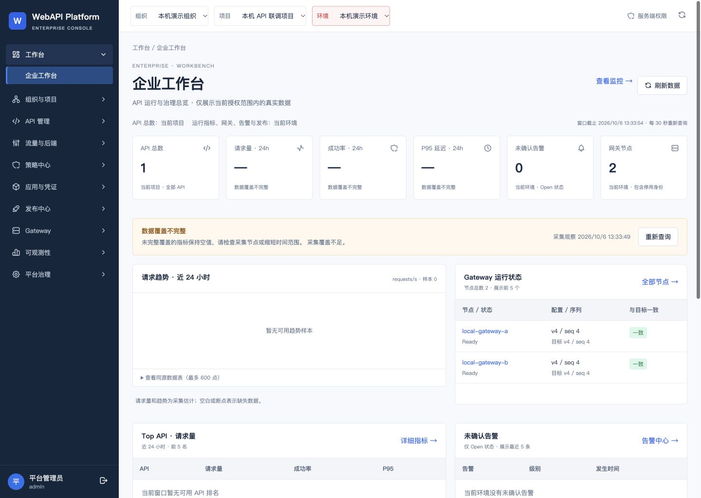

# 企业工作台本机交付结果

日期：2026-10-06。入口：http://127.0.0.1:4192/dashboard 。源码提交 `8026813e69519f59ff79cf7b5581862e5719da93`，本地快进合并，未推送。

## 已交付

启用左侧工作台并新增真实只读聚合页；原根首页组织管理行为保留。包含六项摘要、近24小时请求趋势、Top API、Gateway运行状态、Open告警、最近发布及最近50条发布中的待审批。查看监控、节点、发布和告警入口可操作。

API总数按当前项目读取；其他查询按当前环境读取，各模块分别校验权限。查询独立成功或失败，15秒超时；手动及30秒刷新。切换范围或权限时清除旧数据，取消后的迟到结果不写入。完整口径见 [工作台说明](../../workbench.md)。

## 页面 QA

| 步骤 | 观察结果 | 结论 |
|---|---|---|
| 1 | 1440×1024桌面视口，六卡片、深蓝Shell、当前工作台选中，无水平溢出 | 通过 |
| 2 | 当前管理员实际读取1个API、2个节点、0条Open告警、4条发布 | 通过 |
| 3 | 24小时窗口为Partial；请求量/成功率/P95空值，趋势缺失，无有效请求量时不生成Top排名 | 符合真实采集状态 |
| 4 | 发布、监控24h、Open告警、节点及覆盖页入口；浏览器返回；手动刷新 | 通过 |
| 5 | 原40条覆盖映射保留，第2条已链接/dashboard；仅第11条仍无真实入口 | 通过 |

[完整页面截图](02-deployed-full.png)。临时视口覆盖已重置，临时4182预览已结束，4192工作台保留为交付入口。

## 技术与保留验证

- 控制台与运行工具完整回归182项通过，0失败、0跳过；TypeScript通过。新增模型、真实HTTP与React SSR回归覆盖权限、查询参数、独立错误、取消后的迟到结果、过期指标和详情链接。
- 独立审查指出缺失指标仍作排名、Trace采样比与请求指标混淆两项问题，均已修复并补充先失败后通过的SSR回归；审查最终可合并。
- 从固定提交Git archive构建；镜像 `sha256:f007c2a7966c5ec7c9f6c6cbfd3a2fedc1c6194ab086ce5ba09fab147a9e1064`。运行中3个静态文件SHA与固定构建一致，15个提交文件一致。
- 七个平台卷冷备份及逻辑数据库备份完成并校验；SSO配置包含在私有备份中，原服务恢复，独立IdP未重建。未执行新的恢复演练。
- 原三个账号密码可登录；实际Keycloak Viewer查询指标/节点/告警/发布成功，项目级API计数按其原环境范围权限不读取。Viewer写入403，同客户端退出后401，未扩权。
- 31张业务/治理表、账号密码、SSO、v4/seq4、59个受保护本机文件和19个历史ZIP保持原事实。96个固定维护工具文件校验一致；双网关4196、4197请求返回200，整体Ready。

## 边界

本机现有范围只有一个环境，未新增业务数据演示跨环境切换；范围、权限、取消后的返回已通过自动化用例核验。本轮未重新验收全部40页流程，未重复运行源码未变的后端全量测试。39条有真实或父页入口不表示39页全部后续功能完成。

完整Breaking Change引擎、JWT/重试/缓存、外部通知等继续列后续范围；企业IdP、生产TLS/HA及容量需要目标环境验收。本机Ready不是生产验收。

密码、API Key、Cookie、冷备份和私有执行基线不包含在交付附件中。验证摘要见 `source-commit.json`、`immutable-build.json`、`cold-backup.json`、`upgrade.json`、`real-reads.json`、`final.json`、`ui-qa.json`。
