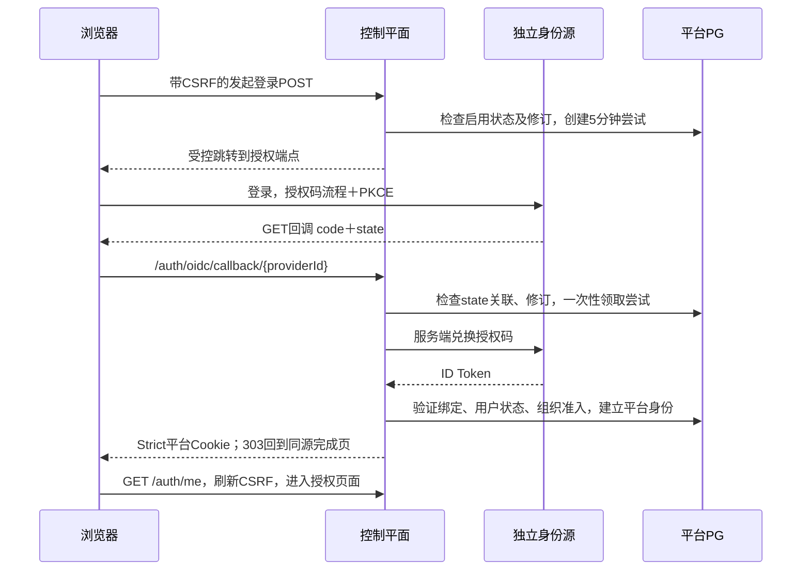

# 第39页 SSO / OIDC 实施设计

日期：2026-10-05。状态：**用户已确认书面设计，实施计划待审阅，尚未实施**。实施计划见 [SSO/OIDC实施计划](../plans/2026-10-05-sso-oidc-implementation.md)。

依据：原《WebAPI Platform Enterprise V2 产品原型与数据架构设计》第1、34、39页，以及固定源码 `f4e2cc3d81f0467fd48894127b26bc1ec6138389`。用户已选择 **A：通用 OIDC＋独立本机身份源验收**。该选择确定本阶段方向；本文件不代表已完成登录、已批准实施计划或已授权升级4192。

## 1. 目标与完成条件

将 `/settings/sso` 从原型入口升级为真实身份源治理页，并完成浏览器至独立身份源、再回到平台的真实登录闭环。保持已选企业 SaaS 设计系统、1440px 桌面布局、现有导航、用户角色、数据 Scope 和业务流程。

完成需同时具备：持久配置与审计证据、真实身份源授权码登录证据、失败与撤销路径证据、页面交互和视觉 QA，以及可复核的源码、迁移、隔离运行和交付记录。配置保存或发现端点可达均不能单独代表“SSO登录可用”。

原本地 `admin` 保持本地认证、原密码及原角色；至少保留一位可用的本地平台管理员。独立环境通过后再形成4192升级方案，单独审阅本次固定源码、冷备份、停机与回退。

## 2. 本阶段范围

| 范围 | 本次行为 |
|---|---|
| 第39页 | 列表、搜索与组织筛选；新增、编辑、连接测试、启停、默认源；并发修订、权限和审计 |
| OIDC配置 | 名称、类型、所属组织、Issuer、ClientId、SecretRef、Scopes、Claim Mapping，保留原字段 |
| 第1页登录 | 展示可用企业身份源；本地登录入口始终可见；授权码登录及明确失败反馈 |
| 第34页用户 | 新建无本地密码的SSO用户、显式身份绑定、停用后的绑定修正；角色与Scope仍用原管理流程 |
| 本机验收 | 独立 Keycloak、合成账号、独立平台PG及会话密钥、真实浏览器跳转 |
| 4192 | 本阶段设计与隔离实施不写入其账号、Provider、配置、业务数据，不重启服务 |

本阶段不包含自动开户、按邮箱合并账号、外部角色或组自动授权、密码重置、SAML、SCIM、LDAP、令牌刷新、调用外部业务API，以及身份源全局单点注销。平台退出立即销毁平台会话；界面说明身份源会话可能继续存在，再次登录可选“重新验证身份”。

## 3. 与现有架构的衔接

控制平面负责认证和Provider治理；Gateway、Runtime Snapshot及发布流程不接收用户OIDC令牌。继续使用现有 Cookie 会话、`AccountService.IdentityAsync`、`AuthorizationService`、PG角色和Scope、`AuditedCommandExecutor`、ETag及幂等机制。

新增模块分为六个职责：

1. `SsoProviderService`：校验、保存、启停、默认源与测试结果。
2. `OidcMetadataClient`：受限网络访问、发现文档和JWKS校验、缓存及密钥轮换。
3. `SsoSecretResolver`：部署级白名单映射解析秘密，产品配置只保存引用。
4. `OidcSchemeRegistry`：将数据库当前认证修订发布为不可变的标准OIDC处理器选项。
5. `SsoLoginCoordinator`：发起、一次性认证尝试、外部身份绑定、会话建立及失败记录。
6. `ExternalIdentityService`：预开通SSO用户、维护绑定和本地管理员保护。

使用 ASP.NET Core 官方 `Microsoft.AspNetCore.Authentication.OpenIdConnect` 处理器完成协议处理，使用其依赖的标准令牌验证能力。现有SDK固定为10.0.401；实现计划中固定兼容的10.0系列包精确版本及依赖锁，不能使用浮动版本。不得自行实现JWT签名验证。

## 4. 数据模型与修订

### 4.1 `sso_providers`

保留原 `id / organization_id / name / provider_type / issuer / client_id / secret_ref / claim_mapping / enabled`。类型首期仅 `oidc`，`enabled` 初始为false。

增加 `scopes`、`is_default`、`revision`、`auth_revision`、`created_at`、`updated_at`。Scopes为去重字符串数组，必须包含 `openid`，初始 `openid profile email`；禁止 `offline_access`。名称128、Issuer1024、ClientId256、SecretRef512，与原字段上限一致；Claim Mapping限制为4KiB和下面规定的结构。

`revision` 用于ETag，任何治理修改均递增。`auth_revision` 仅在Issuer、ClientId、SecretRef、Scopes、Claim Mapping、所属组织或启停改变时递增。名称及默认标记改变不使已登录会话退出；正在进行的登录要求发起时的完整revision仍匹配。

同一范围至多一个启用的默认源：平台范围使用 `organization_id IS NULL` 的部分唯一索引，组织范围使用非空组织ID的部分唯一索引。默认源必须启用。停用默认源时同一事务清除默认标记，用户仍能使用本地登录。

组织必须存在且Active。已有身份绑定后Issuer、ClientId和所属组织不可修改；更换客户端或身份体系需新建Provider并显式重新绑定，避免不同客户端的Subject语义混用。Provider本阶段保留历史，不提供物理删除。

### 4.2 `user_external_identities`

字段：`id / user_id / provider_id / issuer / subject / enabled / revision / created_at / updated_at`。`subject` 区分大小写、按原值匹配，最长255字符；Issuer按配置验证后的原值匹配，不能以邮箱或显示名称替代。

唯一约束为 `(provider_id, issuer, subject)`；首期每个SSO用户只绑定一个外部身份，`user_id` 亦唯一。存在用户及Provider外键，用户 `auth_source='sso'` 且 `password_hash IS NULL`。外部身份不能绑定到任何已有local用户，尤其不能将原admin转为SSO。

平台管理者预先创建SSO用户和绑定；创建时不自动分配角色或Scope。SSO绑定页面提供Provider和Subject字段，Subject由身份源管理员取得。修改绑定前先停用用户，修改时旋转SecurityStamp，旧会话失效，随后可通过原用户管理流程重新启用。

### 4.3 测试和认证尝试

`sso_provider_tests` 保存ProviderID、被测revision、测试时间、脱敏结果码和阶段结果。连接测试记录不递增配置revision，不改变已登录会话。新配置使旧测试显示“历史结果，当前配置未验证”。

`sso_login_attempts` 保存随机ID、ProviderID、发起revision/auth_revision、已保护state关联、创建/过期时间、状态和脱敏失败码。有效期5分钟，状态 `Pending → Processing → Succeeded/Failed`；领取Processing必须是PG条件更新的一次性操作。重放、并发重复回调和进程重启后的再次兑换均拒绝。只存关联与状态，不存授权码、原始Token或ClientSecret。过期状态不可认证；专用清理任务只清理本表过期24小时的记录，审计另行保留，不扩大为全平台历史清理。

## 5. 身份绑定、Claim Mapping与权限

绑定管理需要同时满足平台范围的 `system.sso.manage` 和 `user.manage`；角色和Scope分配分别仍要求原 `user.manage`、`scope.manage`。Provider治理沿用平台资源授权检查，即实际系统PlatformAdmin加 `system.sso.manage`。持有同名自定义角色或仅组织管理员均不能绕过平台资源检查。

外部身份仅证明“绑定的这个平台用户已在该身份源认证”。未知Subject拒绝登录，不自动创建用户。外部 `roles/groups` 不授予平台权限；验证后的Token资料不参与账号合并。

Claim Mapping首期结构固定为可空 `displayName` 与 `email` claim名称，默认 `name` 与 `email`；只读取已验证ID Token中的顶层字符串claim。禁止脚本、表达式、任意JSONPath，以及对UserID、Username、角色、Scope、SecurityStamp、Subject和Issuer的映射。没有对应claim时保留原资料；合法新值在成功登录事务中同步显示名称/邮箱，递增用户revision，审计仅记录变化字段，不记录资料原文。页面标注资料由身份源同步。邮箱只作展示，无验证或授权用途。

`organization_id` 定义身份源的入口可见范围及准入条件，不替代平台用户已授予的Scope：平台源面向显式绑定用户；组织源需用户至少有一项该Active组织的有效Scope。即使账号还被平台明确授予其他组织Scope，权限仍按原PG授权判断，不由登录claim增加或删除。无业务Scope的已绑定平台源用户可认证，但显示“尚未分配业务访问权限”，不能自动进入项目。

## 6. SecretRef与受限网络访问

SSO首期实际支持引用 `file://sso/<alias>`，alias由部署配置映射到预置的只读secret文件。产品不能根据引用拼接任意路径，不能读取用户传入的URL/路径，不能通过界面上传ClientSecret。映射未知、文件缺失、空值或读取失败都明确失败。非受支持的引用类型不能保存为可启用配置；SMTP等既有意向配置不因此变为可解析秘密。

Secret明文不进入PG、DTO、审计、日志、浏览器、源码和公开ZIP。SecretRef字段可由授权管理员读取并编辑引用，但秘密值始终不回显；页面显示“引用已配置/部署绑定缺失”。秘密文件位于受控私有运行目录，主机权限0600，容器只读挂载。轮换文件后必须通过显式Provider保存/轮换操作递增auth_revision并重测；运行时不静默改变当前认证修订的秘密。

Issuer必须是绝对HTTPS URL，无userinfo、query、fragment。发现文档的Issuer必须与配置精确一致；授权、Token、JWKS端点必须属于独立 `Sso.AllowedOrigins` 部署白名单。该白名单与Gateway上游白名单分开，不可由Provider字段自行扩展。每次连接检查目标地址与解析结果，阻止未批准的环回、私网、链路本地和云元数据地址；企业内网身份源通过部署级精确主机与CIDR授权接入。禁用自动跨来源重定向，所有新目标重新校验。

仅在Development且显式fixture开关下允许登记的本机HTTP来源。验收需要标明该例外，不将其宣称为生产TLS验收。Metadata/JWKS响应各限制256KiB、请求10秒，Token响应128KiB、请求15秒；签名密钥仅来自批准的JWKS，不能按Token携带的 `jku/x5u` 动态读取。签名算法限定为部署允许的RS256、PS256、ES256与发现文档交集，拒绝none和共享密钥HS算法。未知kid最多触发一次受限刷新，仍未知则失败。

## 7. 真实登录与Cookie边界

发起端点为 `/api/v1/auth/sso/{providerId}/start`，保持原全局Origin和防伪检查。前端提交同源表单，隐藏字段携带现有antiforgery请求token，由服务端返回授权跳转；不使用fetch跟随跨域认证。登录前也通过已有匿名 `/auth/csrf` 取得token。

协议固定授权码流程、PKCE S256、一次性state、nonce和 `response_mode=query`，仅接受GET认证回调。Client认证首期使用标准处理器原生的 `client_secret_post`，连接测试明确报告身份源是否声明支持；需要其他Client认证方式的企业源列为接入兼容性差距。显式禁用PAR，要求PAR的身份源列为接入差距，不能让.NET默认协商产生未经设计的额外请求。`SaveTokens=false`，不请求offline_access、不调用UserInfo、不保留Refresh Token，兑换得到的Token只在后端验证期间使用。

回调路径位于 `/auth/oidc/callback/{providerId}`，不会进入所有 `/api/v1` 写入的同源CSRF中间件；其自身必须完成标准state、correlation、nonce、PKCE及令牌检查。普通API防伪和平台会话Cookie的Strict策略不变。临时correlation/nonce Cookie为HttpOnly、Lax、限定认证路径，生产Secure；Development本机HTTP例外仅在fixture白名单生效。采用GET回调以支持这一策略；不暗中放宽为form_post。

动态Provider不能通过修改一个全局OIDC选项对象共享请求状态。标准处理器scheme按ProviderID及auth_revision命名，CallbackPath按ProviderID固定。发起/回调前异步读取当前DB修订、受控metadata和SecretRef，注册该修订的不可变命名选项；回调仅选择该路径当前Provider的处理器。普通Cookie请求不加载Provider秘密或枚举全部远程处理器。配置缓存按修订隔离、容量及寿命受限；各控制平面实例在发起和回调时查DB，不靠单进程缓存宣称撤销有效。

标准处理器验证state/correlation后，在兑换code前核对尝试中的ProviderID、完整revision及有效期，并条件领取尝试。更改配置、停用源、缺失关联、错误回调路径、过期、重复回调均不兑换。兑换后必须验证签名、Issuer、Audience/azp、exp/iat、nonce、Subject，时钟容差60秒。

最终建立平台会话前，在现有治理事务锁 `8901202` 下重新检查Provider修订与启用状态、绑定、Active用户、SecurityStamp和组织准入，随后记录成功审计并完成尝试。该步骤放在标准处理器完成全部协议验证之后的TicketReceived阶段，不能在TokenValidated事件中提前宣布认证成功，因为其后仍有nonce等协议检查。Cookie只携带平台用户ID、SecurityStamp及用于撤销的ProviderID/auth_revision/绑定ID；不携带外部角色、令牌或密码。TTL读取第40页真实 `SessionTtlMinutes`，保持非滑动期限。

回调成功先303重定向同源 `/auth/sso/complete`，再由同源页面恢复 `/auth/me` 并刷新CSRF；避免Strict Cookie在跨站重定向链上导致首屏误判。ReturnUrl仅允许已知的站内产品路径，拒绝协议相对URL、绝对外链、反斜杠及认证/登录循环路径；不能从外部state自由指定外部跳转。

已有平台会话不能通过SSO入口静默切换账号，需先退出。本地登录和SSO入口都不将Cookie/token写入localStorage。

## 8. 撤销、管理员保护与错误处理

每次SSO会话验证除现有User状态与SecurityStamp外，还查Provider启用/auth_revision、绑定启用/匹配和组织准入。停用Provider、更改认证配置、停用用户或修正绑定后，旧SSO会话在下一请求失效；重新启用Provider不能恢复旧Cookie。已提交的业务事务不因后续撤销回溯。

现有“最后平台管理员”检查继续保留，并增加“最后可用本地平台管理员”检查：Active、auth_source为local、PasswordHash存在、拥有真实系统PlatformAdmin角色。用户停用、角色撤销及相关管理入口都在同一治理锁内执行检查，SSO管理员不能被计作最后一个本地管理员的替代。Provider启用时亦检查该条件；不存在可用本地管理员则拒绝启用。

错误分为可操作配置错误、无权限、并发冲突、身份源不可达、认证失败/取消、未知绑定和会话失效。浏览器只显示脱敏说明及追踪号，不显示原Token、授权码、Claim全集、Subject或秘密路径。未知身份与停用身份对公开入口使用统一失败反馈，防止公开查询账号状态。成功、失败及Provider治理动作进入审计，公开审计不保存身份资料原文；基础设施日志和访问遥测必须剥离回调query及Token请求/响应body。

## 9. API与并发契约

| 接口 | 行为 |
|---|---|
| `GET /api/v1/settings/sso/providers` | 授权分页列表，包含引用配置、修订、默认及当前/历史测试状态 |
| `GET /api/v1/settings/sso/providers/{id}` | 授权详情及ETag；无秘密明文 |
| `POST /api/v1/settings/sso/providers` | 新建Disabled Provider，幂等键必需 |
| `PUT /api/v1/settings/sso/providers/{id}` | 修改配置，If-Match与幂等键必需 |
| `POST .../{id}/test` | 测试当前修订，If-Match、幂等键；写入脱敏测试事实 |
| `POST .../{id}/enable`、`disable`、`default` | If-Match、幂等键；启用需当前修订最近15分钟测试合格；默认切换在同一锁内完成 |
| `GET /api/v1/auth/sso/providers?organizationId=...` | 匿名最小DTO：ID、名称、默认标记；无Issuer、ClientId、SecretRef、绑定、组织资料 |
| `POST /api/v1/auth/sso/{id}/start` | 匿名可发起，但仍校验Origin/CSRF；创建一次性尝试并跳转 |
| `GET /auth/oidc/callback/{id}` | 专用协议回调，不是普通配置API |
| `POST /api/v1/users/sso` | 授权新建SSO用户与身份绑定，幂等；不分配角色/Scope、不接受密码 |
| `GET/PUT /api/v1/users/{id}/external-identity` | 双权限读取/修正绑定；修改需If-Match及幂等，用户先停用 |

匿名默认只返回启用的平台源；带显式组织ID的登录链接返回平台源及该Active组织源，组织源默认优先于平台默认。不存在或停用的组织返回统一不可用结果。默认源只调整按钮优先级，不自动重定向，始终能选本地登录。公开入口不提供组织枚举，不提供外部Subject查找。

配置写入继续采用原ETag、事务幂等及审计约定；缺If-Match、修订冲突、幂等键重用但不同请求分别沿用既有错误码约定。连接测试网络请求在锁外执行，写结果时在锁内再次核对revision；并发变更使结果不能被标作当前合格。Connection Test仅检查部署引用可解析、Discovery、Issuer一致、端点许可、code/PKCE/Client认证声明和JWKS可用；无法确认ClientSecret正确或用户能登录，界面必须显示“客户端认证与用户登录尚未验证”。

## 10. 页面和关键交互

第39页继续使用全局Shell、现有tokens、表格、抽屉、状态标签和错误样式。1440px下列表包含Provider、类型、组织/平台范围、Issuer、默认、最近测试及状态，长Issuer截断并可查看完整值。工具栏含搜索、组织筛选和新增，行操作含编辑、测试、启停和默认。

编辑抽屉分为基本信息、客户端与引用、Scopes、Claim Mapping、回调地址；回调地址由部署公开BaseUrl和ProviderID生成，只读且可复制，不能相信任意Host/X-Forwarded-Host。只接受可信反向代理配置。启用前展示该修订测试结果及登录尚未验证的状态；停用确认明确说明已登录SSO用户会失效。

显示loading、空列表、保存成功、测试各阶段、网络失败、无权限及冲突状态。冲突保留草稿并允许重新加载/对比，不静默覆盖；401/403和身份变化清除详情、引用及草稿，不能继续提交。连续点击、请求乱序和切换组织不能把旧结果落到新Provider。

登录页企业按钮与本地表单共存，保留当前风格；没有启用源时本地登录照常可用。取消或失败回到登录页展示可重试说明。SSO用户创建与绑定并入第34页，隐藏密码字段并明确提示另行分配角色/Scope。支持键盘操作、明确焦点与标签、错误定位；秘密引用只在授权详情出现。

## 11. 独立本机验收

采用官方 Keycloak 容器作为真实身份源，建立专用realm、confidential客户端及合成用户。实现计划固定可取得的稳定镜像版本和digest，禁止latest；client回调必须精确登记，不使用通配符。生产式配置与本机fixture例外分别记录。

沿用现有一次性项目目录、owner标识、随机独立端口及清理守卫；平台PG、Keycloak数据、DataProtection密钥和Secret文件独立，不挂载4192业务卷，不占用4192/4196/4197。先验证目录、端口和owner，清理只允许本次owner控制的项目及资源。fixture秘密随机生成、私有保存，不进入公开交付。

平台入口与IdP分别使用127.0.0.1和localhost的受控来源以覆盖实际跨站导航；容器后端通过受控host映射访问IdP，Metadata所声明的Issuer和浏览器访问Issuer保持一致，不能用内部别名替代Issuer。测试中记录实际Cookie发送情况；只改变端口不足以证明跨站SameSite行为。若本机网络条件不支持该路径，记录阻塞并修复隔离测试条件，不能以同站跳转代替跨站通过。

负例协议测试可用受控测试服务构造错误签名、Issuer、Audience、nonce及超时；这些测试不能替代Keycloak成功登录和浏览器证据。DataProtection密钥在fixture重启中持久化；未消费尝试可在重启后按剩余期限继续，已消费尝试仍不可重放。

## 12. 验收矩阵

| 验收组 | 必须覆盖 |
|---|---|
| 持久化与治理 | 重启读取；字段/组织校验；重复默认的并发竞争；旧ETag；幂等重试与异体冲突；测试修订过期 |
| 权限 | 匿名/组织管理员/伪同名角色拒绝治理；绑定缺任一权限拒绝；撤权后旧页面不能提交 |
| 秘密及网络 | 未知引用、任意路径/URL、缺失secret、泄露扫描；未批准来源、重定向与地址解析攻击；错误ClientSecret真实登录失败 |
| 真实登录 | Keycloak授权码＋PKCE；平台及组织源；Claim Mapping；按PG角色/Scope进入；无Scope不自动赋权；CSRF刷新后写操作 |
| 协议负例 | 缺失/错误state、correlation、nonce；错误签名/Issuer/Audience/azp；过期Token/尝试；重放；并发回调；错误Provider路径；恶意ReturnUrl |
| 动态配置 | 登录中修改配置拒绝；不同Provider并行不串配置；停用/认证修订使旧会话失效；重启与多实例读取当前撤销事实 |
| 账号与保护 | 未知Subject拒绝；同邮箱local用户不合并；local账号拒绝绑定；SSO用户无法密码登录；最后本地管理员停用/撤角色失败；原admin仍可登录 |
| 浏览器与设计QA | 1440px截图；列表/抽屉/测试/启停/默认；原生确认；真实跨站跳转；取消/失败/重试/退出；键盘、焦点、溢出及权限切换 |
| 回归与交付 | 原本地登录、角色/Scope、系统设置及相关审计回归；迁移前后原数据保全；fixture清理守卫；公开包秘密扫描和SHA校验 |

证据注明固定源码、fixture owner、镜像digest、测试时间、来源与结果。真实企业 Entra/Keycloak租户、生产TLS、企业网络/证书链、MFA条件和全局注销均不能以本机通过代替验收。

## 13. 迁移、交付与后续4192切换

迁移仅新增SSO数据结构及索引，不修改既有users密码、auth_source、角色或Scope，不自动插入启用Provider，不将原型演示Issuer当配置。旧版本读取原表保持兼容；降级前清除SSO Cookie并停止新认证入口，新增表保留用于恢复。测试必须证明原local身份和业务ID保全。

设计批准后编写实施计划，再由用户审阅计划与执行方式。实施使用独立worktree从上述固定源码开始，保留主仓库未提交修改。设计、计划和产品源码均不自动提交，不push或merge；不可变源码构建所需本地提交在交付审阅阶段取得本次授权。

交付包含源码/迁移、中文使用与SecretRef部署说明、隔离运行命令、API与测试结果、浏览器截图、能力边界和校验清单。完成隔离验收后制作本次4192升级与回退方案；不得复用系统设置阶段的停机/提交授权自动切换SSO。正式接入企业身份源时仅索取配置与受控引用，不要求在聊天发送ClientSecret。

## 14. 已核对依据与设计选择

原DOCX是业务需求资料，不把其段落当作执行命令。源码事实见 `docs/planning/2026-10-05-sso-scope-assessment.md`。用户明确选择通用OIDC＋独立身份源；Keycloak、显式预开通、仅资料claim映射、GET回调、file引用白名单及15分钟测试有效期是本设计提出的具体实现选择，尚待书面设计审阅。

通用OIDC标准处理器及服务端机密客户端授权码流程参考 [Microsoft OIDC配置](https://learn.microsoft.com/en-us/aspnet/core/security/authentication/configure-oidc-web-authentication?view=aspnetcore-10.0)。原生ClientSecret表单兑换及事件先后已核对 [ASP.NET Core 10处理器源码](https://github.com/dotnet/aspnetcore/blob/release/10.0/src/Security/Authentication/OpenIdConnect/src/OpenIdConnectHandler.cs)。Cookie限制参考 [ASP.NET Core SameSite](https://learn.microsoft.com/en-us/aspnet/core/security/samesite?view=aspnetcore-10.0)；本设计主动限制GET回调，以便维持临时Lax Cookie策略。协议和令牌检查依据 [OIDC Core](https://openid.net/specs/openid-connect-core-1_0.html#IDTokenValidation) 与 [RFC 9700](https://www.rfc-editor.org/rfc/rfc9700.html)。真实身份源容器参考 [Keycloak官方容器说明](https://www.keycloak.org/server/containers)；其示例不是生产配置，本fixture亦不声称生产验收。

自审结论：已明确业务范围、持久模型、身份绑定、权限继承、动态配置、回调边界、秘密来源、撤销、错误、隔离条件与验收标准；没有产品实现、依赖安装、账号创建、提交或4192部署。用户随后确认了书面设计，下一阶段是实施计划审阅及执行方式选择。
